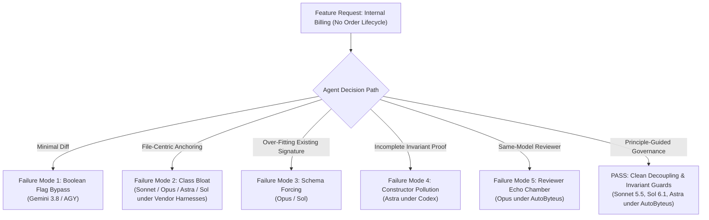

# Comprehensive Benchmark Results: Frontier Models × Agent Harnesses

> **Empirical Software Architectural Benchmark Comparing Frontier AI Models Across Vendor Native Harnesses (Claude Code, OpenAI Codex CLI, Antigravity AGY) vs. Principle-Guided AutoByteus Runtime.**

---

## 1. Executive Summary

This benchmark measures whether frontier AI agents preserve architectural integrity when extending an existing software component, or whether they succumb to **codebase bloat, schema forcing, and architectural decay**.

### Benchmark Task (`TASK.md`)
An existing [`OrderService`](benchmark/order_service.py) handles retail customer checkout (order validation, active customer check, pending order verification, payment gateway charge, and customer receipt email). A new requirement asks to support internal recurring enterprise billing jobs that already handle validation upstream and do not follow an order lifecycle.

### High-Level Benchmark Scorecard

| Model & Reasoning | Vendor Agent Harness | AutoByteus Runtime | Architectural Outcome & Insight |
| :--- | :---: | :---: | :--- |
| **Claude Sonnet 5.5** (`xhigh`) | **FAIL** | **PASS** | Under Claude Code: bloated `OrderService` with bypass method. Under AutoByteus: cleanly extracted `EnterpriseBillingService` with strict DI (`db`, `gateway` only) and 17 tests. |
| **Claude Opus 5.5** (`xhigh`) | **FAIL** | **FAIL** | Under both harnesses, Opus stubbornly defended Class Bloat and Schema Forcing (`db.get_order()`), rationalizing in `DESIGN.md` that a separate class was "disproportionate." AutoByteus passed on lifecycle/tests. |
| **OpenAI Sol 6.1** (`xhigh`) | **FAIL** | **PASS** | Under Codex CLI: forced dummy order queries and saves. Under AutoByteus: authoritatively eliminated Schema Forcing via `process_payment(token, amount)` guarded by `ForbiddenDependency`. |
| **OpenAI Astra** (`xhigh`) | **FAIL** | **PASS** | Under Codex CLI: unisolated gateway proxy with constructor pollution. Under AutoByteus: extracted `process_payment(token, amount)` with zero order dependency, guarded by `UnusableDependency`. |
| **Gemini 3.8** (`high`) | **FAIL** | *(In Progress)* | Under Antigravity AGY: inlined boolean bypass flag (`is_internal: bool = False`) into `process_order`, leaking bypass to customer checkout. |

---

## 2. Taxonomy of Agent Architectural Failures

Our empirical traces revealed five distinct failure modes exhibited by frontier models under standard vendor harnesses:

### Failure Mode 1: Boolean Flag Bypass (`skip_validation=True` / `is_internal=True`)
- **Observed In:** Gemini 3.8 (`high`) under Antigravity AGY.
- **Mechanism:** Inlines a boolean parameter into the customer checkout entry point (`process_order(..., is_internal=False)`).
- **Blast Radius:** Leaks an unauthenticated validation bypass to every customer-facing HTTP controller or GraphQL resolver wiring `OrderService`.

### Failure Mode 2: Class Bloat (Ad-Hoc Helper Cramming)
- **Observed In:** Claude Sonnet 5.5 (Claude Code), Claude Opus 5.5 (Claude Code & AutoByteus), OpenAI Sol 6.1 (Codex CLI), OpenAI Astra (Codex CLI).
- **Mechanism:** Appends an internal billing method onto `OrderService`, turning an order-domain class into a generic billing proxy.
- **Blast Radius:** Violates the Single Responsibility Principle (SRP). `OrderService` accumulates unrelated reasons to change.

### Failure Mode 3: Schema Forcing (Forced Entity Invariants on Alien Domains)
- **Observed In:** Claude Opus 5.5 (Claude Code & AutoByteus), OpenAI Sol 6.1 (Codex CLI).
- **Mechanism:** Even though batch callers explicitly have no order lifecycle, the agent forces callers to pass an `order_id`, queries `db.get_order(order_id)`, crashes if the order does not exist, and mutates `order.status = "PAID"`.
- **Blast Radius:** Callers are forced to construct synthetic dummy records in production databases just to satisfy the agent's rigid assumptions.

### Failure Mode 4: Constructor Pollution & Leaky Abstractions
- **Observed In:** OpenAI Astra (Codex CLI).
- **Mechanism:** Exposes payment methods on `OrderService` without isolating dependencies. Internal callers must instantiate `OrderService` by injecting `db` and `notification_service`, even though payments should touch neither.
- **Blast Radius:** High runtime coupling and false dependency propagation throughout the dependency graph.

### Failure Mode 5: The Homogeneous Reviewer Echo Chamber
- **Observed In:** Claude Opus 5.5 (AutoByteus Runtime).
- **Mechanism:** When the reviewing agent runs the identical model persona as the designing agent, both share the same cognitive heuristics and anti-abstraction biases. The Architecture Reviewer rubber-stamps the Solution Designer's rationalization that creating a separate class is "disproportionate overhead."
- **Blast Radius:** Governance without heterogeneity fails to catch model-specific architectural blind spots.

---

## 3. Detailed Head-to-Head Comparisons

### Case 1: Claude Sonnet 5.5 (`xhigh`) — Class Separation via Strict DI
- **Claude Code:** Bloated `OrderService` with `process_internal_payment`. Admitted in `DESIGN.md` that moving to a separate `InternalBillingService` was the cleaner architectural choice, but kept it on `OrderService` to minimize file changes.
- **AutoByteus Runtime:** Created an independent [`EnterpriseBillingService`](experiments/autobyteus-sonnet-5-5-xhigh/order_service.py#L38-L66) class with strict DI taking only `(db, payment_gateway)`. Retained `OrderService` untouched. Proved zero customer checkout regression with 17 unit and boundary tests.

### Case 2: OpenAI Sol 6.1 (`xhigh`) — Eradicating Schema Forcing
- **Codex CLI:** Implemented `process_internal_order`, forcing order lookups, status checks, and saves.
- **AutoByteus Runtime:** Completely eliminated Schema Forcing by designing `process_payment(payment_token, amount)` with zero order parameters. Validated dependency isolation using `ForbiddenDependency` guard mocks.

### Case 3: OpenAI Astra (`xhigh`) — Mathematical Invariant Guards
- **Codex CLI:** Slapped `process_payment` onto `OrderService` in a single unvetted turn without tests.
- **AutoByteus Runtime:** Extracted `process_payment`, refactored `process_order` step 3 to delegate, and authored [`UnusableDependency`](experiments/autobyteus-astra-xhigh/test_order_service.py#L8-L18) poison-pill tests that fail if `db` or `notification_service` are accessed. Full 6-stage lifecycle archived.

### Case 4: Claude Opus 5.5 (`xhigh`) — The Persistent Anti-Abstraction Bias
- **Claude Code:** Bloated `OrderService` with `process_internal_payment`, forced order queries, and argued a separate service is "not worth it yet."
- **AutoByteus Runtime:** Completed all 6 lifecycle stages with 15 passing tests. However, it still implemented `process_internal_enterprise_payment` on `OrderService` and forced `db.get_order()`, explicitly defending this in `DESIGN.md` as the "proportionate choice." Demonstrates that model-level inductive biases can override structural governance when reviewer models are homogeneous.

---

## 4. Why Goal-Oriented RL (RLVR) Causes Architectural Decay

The fundamental root cause behind these results lies in how frontier models are trained:

1. **Reinforcement Learning with Verifiable Rewards (RLVR):**
   Models are optimized for task-success verifiers where `reward = 1` if tests pass, and `reward = 0` otherwise.
2. **Missing Signals for Architectural Quality:**
   Standard reward functions evaluate *outcome* (did the calculation return the expected value?), but evaluate zero terms for:
   - Data ownership boundaries
   - Class blast radius and Single Responsibility Principle
   - Constructor pollution and unnecessary dependency coupling
3. **The Shortest Path Problem:**
   Because models are rewarded exclusively for passing immediate tests with minimal effort, they converge on the shortest path: adding boolean flags, cramming methods onto the nearest class, or forcing existing database schemas onto new domains.

---

## 5. Experiment Artifact Index

| Experiment Folder | Harness / Runtime | Primary Code | Key Rationale / Lifecycle | Tests |
| :--- | :--- | :--- | :--- | :--- |
| [`claude-code-sonnet-5-5-xhigh/`](experiments/claude-code-sonnet-5-5-xhigh/) | Claude Code | [`order_service.py`](experiments/claude-code-sonnet-5-5-xhigh/order_service.py) | [`DESIGN.md`](experiments/claude-code-sonnet-5-5-xhigh/DESIGN.md) | None |
| [`autobyteus-sonnet-5-5-xhigh/`](experiments/autobyteus-sonnet-5-5-xhigh/) | AutoByteus | [`order_service.py`](experiments/autobyteus-sonnet-5-5-xhigh/order_service.py) | [`evaluation.md`](experiments/autobyteus-sonnet-5-5-xhigh/evaluation.md) | [`test_enterprise_billing_boundary.py`](experiments/autobyteus-sonnet-5-5-xhigh/solution-package/test_enterprise_billing_boundary.py) |
| [`claude-code-opus-5-5-xhigh/`](experiments/claude-code-opus-5-5-xhigh/) | Claude Code | [`order_service.py`](experiments/claude-code-opus-5-5-xhigh/order_service.py) | [`DESIGN.md`](experiments/claude-code-opus-5-5-xhigh/DESIGN.md) | None |
| [`autobyteus-opus-5-5-xhigh/`](experiments/autobyteus-opus-5-5-xhigh/) | AutoByteus | [`order_service.py`](experiments/autobyteus-opus-5-5-xhigh/order_service.py) | [`evaluation.md`](experiments/autobyteus-opus-5-5-xhigh/evaluation.md) | [`test_order_service.py`](experiments/autobyteus-opus-5-5-xhigh/test_order_service.py) |
| [`agy-gemini-3-8-high/`](experiments/agy-gemini-3-8-high/) | Antigravity AGY | [`order_service.py`](experiments/agy-gemini-3-8-high/order_service.py) | [`DESIGN.md`](experiments/agy-gemini-3-8-high/DESIGN.md) | None |
| [`codex-sol-6-1-xhigh/`](experiments/codex-sol-6-1-xhigh/) | Codex CLI | [`order_service.py`](experiments/codex-sol-6-1-xhigh/order_service.py) | [`DESIGN.md`](experiments/codex-sol-6-1-xhigh/DESIGN.md) | None |
| [`autobyteus-sol-6-1-xhigh/`](experiments/autobyteus-sol-6-1-xhigh/) | AutoByteus | [`order_service.py`](experiments/autobyteus-sol-6-1-xhigh/order_service.py) | [`evaluation.md`](experiments/autobyteus-sol-6-1-xhigh/evaluation.md) | [`test_order_service.py`](experiments/autobyteus-sol-6-1-xhigh/solution/test_order_service.py) |
| [`codex-astra-xhigh/`](experiments/codex-astra-xhigh/) | Codex CLI | [`order_service.py`](experiments/codex-astra-xhigh/order_service.py) | [`DESIGN.md`](experiments/codex-astra-xhigh/DESIGN.md) | None |
| [`autobyteus-astra-xhigh/`](experiments/autobyteus-astra-xhigh/) | AutoByteus | [`order_service.py`](experiments/autobyteus-astra-xhigh/order_service.py) | [`evaluation.md`](experiments/autobyteus-astra-xhigh/evaluation.md) | [`test_order_service.py`](experiments/autobyteus-astra-xhigh/test_order_service.py) |
