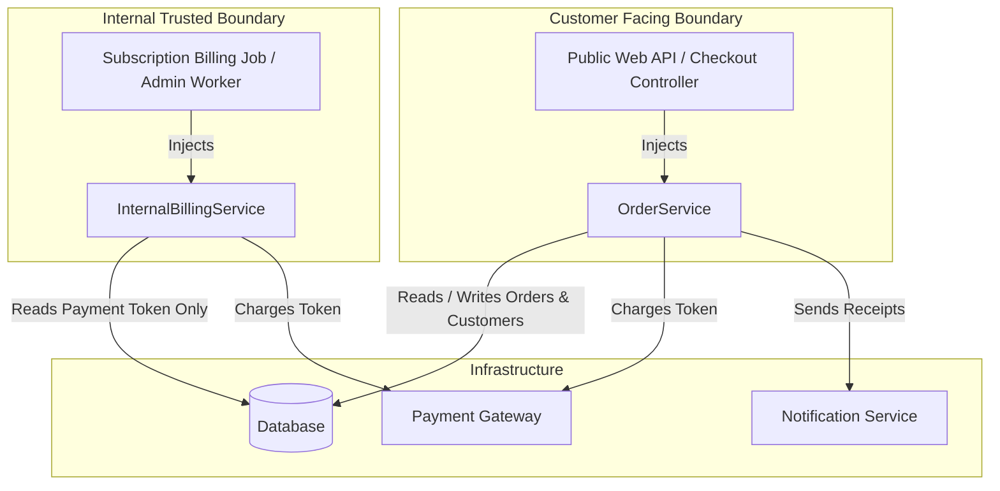

# Architectural Design: Internal Enterprise Billing Service

## 1. Executive Summary & Core Decision

### Core Decision
**Do NOT modify `OrderService`.** 
Leave `order_service.py` 100% untouched to ensure zero customer regression risk and preserve the domain integrity of retail customer order checkouts.

Instead, implement a dedicated sibling service: **`InternalBillingService`** (in `internal_billing_service.py`), designed specifically to meet the needs of internal subscription billing jobs and administrative batch tasks.

### Key Benefits
- **Zero Customer Regression Risk:** Existing customer checkout logic remains completely unchanged and protected.
- **Single Responsibility Principle (SRP):** `OrderService` manages the lifecycle of customer retail orders; `InternalBillingService` manages internal corporate account payment charges.
- **Interface Segregation Principle (ISP):** Callers only depend on the interfaces and dependencies they actually need (`InternalBillingService` has zero dependency on `notification_service`).
- **Security & Boundary Enforcement:** The ability to charge accounts without customer status validation is isolated to internal backend worker processes at the composition root and physically absent from customer-facing API controllers.

---

## 2. Requirements & Domain Boundary Analysis

### Requirements Summary
Internal recurring subscription billing jobs and administrative batch tasks need to charge payments for pre-verified corporate enterprise accounts via the payment gateway without:
1. Validating customer account active status (`is_active`).
2. Requiring or verifying pending order records (`db.get_order()`, status == `"PENDING"`).
3. Updating order state (`order.status = "PAID"`, `db.save_order()`).
4. Dispatching customer receipt emails (`notification_service.send_receipt()`).

### Domain Mismatch Analysis
| Dimension | Customer Checkout Flow (`OrderService`) | Internal Recurring / Batch Billing (`InternalBillingService`) |
| :--- | :--- | :--- |
| **Domain Entity** | Customer Order (cart checkout, order fulfillment) | Corporate Enterprise Subscription / Invoice |
| **Lifecycle** | Multi-state transition (`PENDING` -> `PAID`) | Stateless payment execution / batch settlement |
| **Trust Model** | Untrusted external customer input (requires full fraud & status gates) | Trusted internal background worker (pre-verified upstream) |
| **Notifications** | End-user customer order receipts | Operational / audit logs (no retail receipts) |
| **Dependencies** | `db`, `payment_gateway`, `notification_service` | `db`, `payment_gateway` (no notification service) |

Attempting to merge these two distinct operational contexts into a single class creates conflicting responsibilities, leaky abstractions, and dangerous security bypasses.

---

## 3. Analysis & Rejection of Alternative Approaches

### Rejected Approach A: The "Boolean Bypass Flag" (`skip_validation=True`)
```python
# ANTI-PATTERN: DO NOT USE
def process_order(self, order_id: str, customer_id: str, amount: float, skip_validation: bool = False, skip_notifications: bool = False):
    if not skip_validation:
        ...
```
- **Why Rejected:**
  - Converts fundamental security and domain invariants into optional parameters.
  - Exposes the bypass directly to public-facing API routes and controllers that consume `OrderService`.
  - Introduces branching complexity ("flag bloat") that rapidly degrades maintainability.
  - Forces internal batch tasks to manufacture dummy `order_id` values, coupling batch processing to order persistence.

### Rejected Approach B: The "Class-Bloat Bypass" (`OrderService.process_internal_payment`)
```python
# ANTI-PATTERN: DO NOT USE
class OrderService:
    def process_order(...): ...
    def process_internal_payment(self, account_id: str, amount: float):
        # Bypasses order lifecycle inside OrderService
        ...
```
- **Why Rejected:**
  - **Ownership Violation:** Corporate subscription billing has no order lifecycle. Cramming it into `OrderService` violates SRP.
  - **Interface Pollution & Security Leak:** Any public controller with access to `OrderService` has visibility of `process_internal_payment`, making accidental exposure or exploitation possible.
  - **Unnecessary Coupling:** Batch billing workers would be forced to supply an unused `notification_service` dependency to instantiate `OrderService`.

### Rejected Approach C: Schema Forcing (Synthetic Dummy Orders)
- **Why Rejected:**
  - Creating synthetic `Order` database records solely to satisfy `OrderService` creates database bloat, triggers inappropriate downstream order fulfillment webhooks, and directly violates the requirement that batch jobs do not follow an order lifecycle.

---

## 4. Architecture & Component Design

### Component Structure


### Dependency Scope Comparison
| Service | `db` | `payment_gateway` | `notification_service` | Manages `Order` |
| :--- | :---: | :---: | :---: | :---: |
| `OrderService` | Required | Required | Required | Yes |
| `InternalBillingService` | Required | Required | **None** | **No** |

---

## 5. Security & Composition Root Isolation

The critical design principle for sensitive administrative bypasses is **Isolation at the Composition Root**:
- **Customer Checkout Context:**
  ```python
  # Web API / Customer Checkout DI Container
  order_service = OrderService(db=db, payment_gateway=gateway, notification_service=notifier)
  ```
  `InternalBillingService` is **never** registered or injected into public API handlers. There is no route, controller, or method on `OrderService` through which an external caller can bypass status checks.

- **Internal Batch Worker Context:**
  ```python
  # Internal Billing Daemon / Cron Worker DI Container
  internal_billing_service = InternalBillingService(db=db, payment_gateway=gateway)
  ```
  Internal workers receive only the billing capability they require, cleanly decoupled from order lifecycle management and customer notification delivery.

---

## 6. Verification & Test Strategy

Unit tests located in `test_services.py` validate both isolation and functionality:
1. **Regression Suite (`TestOrderService`):**
   - Asserts full validation enforcement: non-positive amounts, missing customers, inactive customers, missing orders, non-pending orders, and payment failures.
   - Asserts 100% preservation of `OrderService` behavior.
2. **Feature Suite (`TestInternalBillingService`):**
   - Asserts successful charges for pre-verified accounts (including accounts where `is_active=False`).
   - Asserts proper exception handling (`PaymentFailedError`) on payment gateway decline.
   - Asserts input sanity checks (non-positive amounts, non-finite values, missing account ID, missing payment token).
   - Verifies zero interaction with order storage (`db.get_order`, `db.save_order` are never invoked) and zero dependency on `notification_service`.
